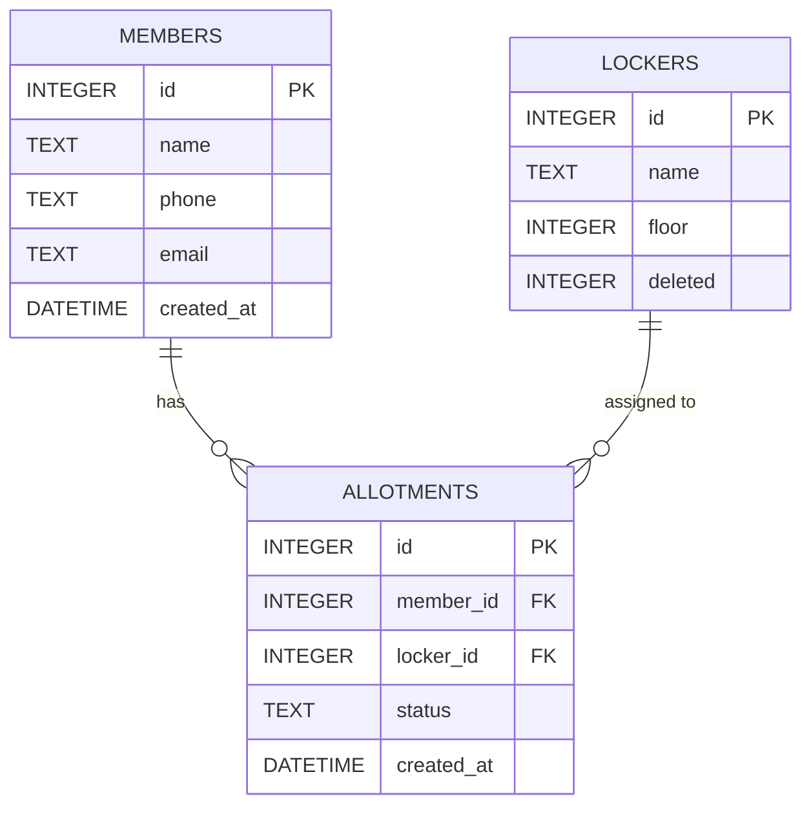

<!-- Owner: Member 4 - Validation, Search & Documentation (REDDEMONI MANIKANTA, 252U1R1220) -->

# FitNest Gym – Locker Room Management REST API

## 1. Project Title, Client Problem, and Tech Stack

### Project Title
**FitNest Gym – Locker Room Management REST API**  
*Academic Project: Theme 1 of 30 | Group ID: YG-CSE2E-G01*

### Client Problem
> *"Our staff write locker numbers on paper. Members forget which locker is theirs, and last week two members were given the same one."*

**The Solution:**  
This REST API digitalizes the locker room operations for FitNest Gym by:
1. Eliminating paper records through persistent relational database tracking.
2. Preventing duplicate active locker assignments: a locker currently in `pending` or `approved` status cannot be simultaneously allotted to any other gym member.
3. Providing clear, human-readable records combining members, lockers, and allotment statuses via a relational SQL JOIN query.
4. Implementing audit-safe soft deletes with instant restore capabilities (Twist 1).
5. Enforcing a strict, forward-only allotment lifecycle (`pending` $\rightarrow$ `approved` $\rightarrow$ `done`) to eliminate clerical errors (Twist 2).

### Tech Stack
- **Runtime & Framework:** Node.js (v18+) with Express.js (v4)
- **Database:** SQLite3 via `better-sqlite3` (synchronous, fast, file-based SQL engine with enforced foreign key integrity)
- **API Testing:** Postman Collection v2.1.0 with automated test assertions
- **Version Control:** Git & GitHub with modular branching per group member

---

## 2. Student Information

| Field | Details |
|---|---|
| **Name** | Reddemoni Manikanta |
| **Registration Number** | 252U1R1220 |
| **Section** | CSE-2E 211 |
| **Course** | Backend Development Fundamentals · Year II Term II |
| **Faculty** | Mr Yugandhar Gurjalwar |
| **College** | Aurora Deemed-to-be-University |

---

## 3. Group Details

**Group ID:** `YG-CSE2E-G01`  
**Theme:** Theme 1 – FitNest Gym (Locker Rooms)

| # | Member Name | Reg. No. | Part | Responsibility | Contribution (What was built) |
|---|---|---|---|---|---|
| 1 | **RAVELLA LOKESH** | 252U1R1217 | Part 1: Server and routes | Express setup, app.js, route files, folder structure, error-handling middleware, status codes | Built Express server (`app.js`, `server.js`), configured routers (`routes/`), implemented centralized 404 and 500 error handlers (`errorHandler.js`), established HTTP status code standards across the API. |
| 2 | **SHISHIRA RAVIKANTI** | 252U1R1218 | Part 2: Database | SQLite connection, 3 tables, foreign keys, deleted field, seed data, reusable query functions | Designed SQL schema with foreign keys and `deleted` column (`schema.sql`), connected SQLite using `better-sqlite3` (`database.js`), authored reusable database query objects, created seed script (`seed.js`) with 15 lockers (including Locker 12). |
| 3 | **CHATHWIK SRI SAI** | 252U1R1219 | Part 3: REST endpoints | Locker CRUD, member CRUD, allotment create, JOIN endpoint | Implemented full CRUD controllers for Lockers (`lockersController.js`), Members (`membersController.js`), Allotment creation logic with double-allotment prevention, and the multi-table relational SQL JOIN endpoint (`/allotments/details`). |
| 4 | **REDDEMONI MANIKANTA** | 252U1R1220 | Part 4: Validation, search and README | Input validation and messages, search by floor, README.md | Built validation middleware (`validate.js`) with standardized `{ "error": "..." }` responses, implemented query-parameter filtering for floor search (`GET /lockers?floor=2`), authored comprehensive project documentation (`README.md`). |
| 5 | **ANILKUMAR REGELLA** | 252U1R1221 | Part 5: Twists and Postman | Soft delete and restore, status flow rule, Postman collection with all test scenarios | Developed Twist 1 soft-delete & restore controllers (`softDeleteLocker`, `restoreLocker`), engineered Twist 2 forward-only status state machine (`pending` $\rightarrow$ `approved` $\rightarrow$ `done`), created export-ready Postman collection with test suites. |

---

## 4. Database Schema and ER Diagram

### Database Tables Summary

1. **`members`**
   - `id`: INTEGER PRIMARY KEY AUTOINCREMENT
   - `name`: TEXT NOT NULL
   - `phone`: TEXT
   - `email`: TEXT
   - `created_at`: DATETIME DEFAULT CURRENT_TIMESTAMP

2. **`lockers`**
   - `id`: INTEGER PRIMARY KEY AUTOINCREMENT
   - `name`: TEXT NOT NULL
   - `floor`: INTEGER NOT NULL (non-negative integer)
   - `deleted`: INTEGER DEFAULT 0 (0 = active, 1 = soft deleted)

3. **`allotments`**
   - `id`: INTEGER PRIMARY KEY AUTOINCREMENT
   - `member_id`: INTEGER NOT NULL, FOREIGN KEY $\rightarrow$ `members(id)`
   - `locker_id`: INTEGER NOT NULL, FOREIGN KEY $\rightarrow$ `lockers(id)`
   - `status`: TEXT DEFAULT 'pending' (`pending` \| `approved` \| `done`)
   - `created_at`: DATETIME DEFAULT CURRENT_TIMESTAMP

### Entity-Relationship Diagram (Mermaid)



---

## 5. Setup and Run Instructions

### Prerequisites
- Node.js (version 18 or above recommended)
- npm (Node Package Manager)

### Step 1: Clone or Navigate to the Project
```bash
cd fitnest-gym-api
```

### Step 2: Install Dependencies
```bash
npm install
```

### Step 3: Seed Sample Data
Seeds 5 gym members, 15 lockers (including Locker 12 on Floor 2), and sample allotments:
```bash
npm run seed
```

### Step 4: Start the Server
```bash
npm start
```
*The server will start listening at `http://localhost:3000`.*

### Step 5: (Optional) Run Automated Verification Suite
Runs the built-in 22-point assertion suite to verify all endpoints, twists, and validations:
```bash
npm test
```

---

## 6. API Endpoint Table

| HTTP Method | URL Path | Description | Success Code | Error Codes |
|---|---|---|---|---|
| **Lockers** | | | | |
| `GET` | `/lockers` | Get all active lockers (excludes soft-deleted) | `200 OK` | `500` |
| `GET` | `/lockers?floor=2` | Filter active lockers by floor number | `200 OK` | `400` (invalid floor), `500` |
| `GET` | `/lockers/:id` | Get locker by ID (404 if soft-deleted or missing) | `200 OK` | `404` (not found), `500` |
| `POST` | `/lockers` | Add new locker (`name`, `floor`) | `201 Created` | `400` (validation), `500` |
| `PUT` | `/lockers/:id` | Update locker details | `200 OK` | `400` (validation), `404`, `500` |
| `DELETE` | `/lockers/:id` | Soft delete locker (sets `deleted = 1`) | `200 OK` | `404` (not found), `500` |
| `POST` | `/lockers/:id/restore` | Restore soft-deleted locker (sets `deleted = 0`) | `200 OK` | `404` (not found), `500` |
| **Members** | | | | |
| `GET` | `/members` | Get all registered gym members | `200 OK` | `500` |
| `GET` | `/members/:id` | Get single gym member by ID | `200 OK` | `404` (not found), `500` |
| `POST` | `/members` | Register a new gym member (`name`, `phone`, `email`) | `201 Created` | `400` (missing name), `500` |
| `PUT` | `/members/:id` | Update member details | `200 OK` | `400`, `404`, `500` |
| `DELETE` | `/members/:id` | Delete member by ID | `200 OK` | `404`, `500` |
| **Allotments** | | | | |
| `POST` | `/allotments` | Assign locker to member (starts in `pending`) | `201 Created` | `400` (missing fields / double allotment), `404` (member/locker missing), `500` |
| `GET` | `/allotments/details` | Multi-table JOIN returning allotment, member & locker names | `200 OK` | `500` |
| `GET` | `/allotments` | Get all raw allotment records | `200 OK` | `500` |
| `PATCH` | `/allotments/:id/status` | Advance allotment status forward by one step | `200 OK` | `400` ("Invalid status change"), `404`, `500` |

---

## 7. Twist Explanations and Test Scenarios

### Twist 1 – Soft Delete and Restore (Locker 12)
- **Concept:** Rather than executing destructive SQL `DELETE FROM lockers`, we set `deleted = 1`. This preserves historical allotment records while hiding the locker from general availability. Restoring sets `deleted = 0`.
- **Test Scenarios:**
  1. `DELETE /lockers/12` $\rightarrow$ Returns **`200 OK`** (`{ "message": "Locker soft-deleted successfully", "id": 12 }`).
  2. `GET /lockers/12` $\rightarrow$ Returns **`404 Not Found`** (`{ "error": "Locker not found" }`).
  3. `GET /lockers` $\rightarrow$ Locker 12 is **absent** from the array.
  4. `POST /lockers/12/restore` $\rightarrow$ Returns **`200 OK`** (`{ "message": "Locker restored successfully", ... }`).
  5. `GET /lockers/12` $\rightarrow$ Returns **`200 OK`** (`{ "id": 12, "name": "Locker 12", "floor": 2, "deleted": 0 }`).
  6. `GET /lockers` $\rightarrow$ Locker 12 has **reappeared** in the array.

### Twist 2 – Strict Forward-Only Status Progression
- **Concept:** Allotments follow a finite state machine:
  $$\text{pending} \longrightarrow \text{approved} \longrightarrow \text{done}$$
  Only an exact one-step forward transition is permitted. Any backwards move, skipped step, or move from `done` is rejected with HTTP `400` and the exact error `{ "error": "Invalid status change" }`.
- **Test Scenarios:**
  1. `POST /allotments` $\rightarrow$ Allotment created with initial status **`pending`** (**`201 Created`**).
  2. `PATCH /allotments/:id/status` with `{ "status": "approved" }` $\rightarrow$ Returns **`200 OK`** (Valid forward step).
  3. `PATCH /allotments/:id/status` with `{ "status": "pending" }` $\rightarrow$ Returns **`400 Bad Request`** with `{ "error": "Invalid status change" }` (Illegal backward step).
  4. `PATCH /allotments/:id/status` with `{ "status": "done" }` $\rightarrow$ Returns **`200 OK`** (Valid forward step).
  5. `PATCH /allotments/:id/status` with `{ "status": "approved" }` $\rightarrow$ Returns **`400 Bad Request`** with `{ "error": "Invalid status change" }` (Done is a terminal state).

---

## 8. Postman Usage Instructions

1. Open **Postman Desktop** or Postman Web.
2. Click **Import** (top left).
3. Select or drag-and-drop the file:  
   `postman/FitNest_Gym.postman_collection.json`
4. The collection **FitNest Gym - Locker Room Management REST API** will appear in your sidebar with 4 organized folders:
   - `Lockers`
   - `Members`
   - `Allotments`
   - `Twist Tests`
5. Ensure your API server is running on `http://localhost:3000` (`npm start`).
6. Click the folder **`Twist Tests`** and click **Run folder** to execute all tests automatically. All pre-configured `pm.test` assertions will pass with green checkmarks!

---

## 9. Demo-Day Cheat Sheet (Viva Questions & Answers)

### Member 1: RAVELLA LOKESH (Server and Routes)
- **Question:** *Why did you split the application into `app.js` and `server.js` instead of keeping everything in one file?*
- **Answer:** *"Separating `app.js` from `server.js` decouples Express configuration and route mounting from the HTTP network listener (`app.listen`). This follows the Single Responsibility Principle and allows automated test frameworks like Supertest or built-in test runners to import `app` and test HTTP endpoints without binding to active system ports or causing port conflicts."*

### Member 2: SHISHIRA RAVIKANTI (Database)
- **Question:** *Why did you have to run `PRAGMA foreign_keys = ON;` in SQLite, and what happens if you forget it?*
- **Answer:** *"By default, SQLite maintains backward compatibility with older versions by disabling foreign key constraint enforcement. If we do not run `PRAGMA foreign_keys = ON;`, SQLite will accept insert operations into `allotments` referencing non-existent `member_id` or `locker_id` values, leading to orphaned records and corrupt relational integrity."*

### Member 3: CHATHWIK SRI SAI (REST Endpoints)
- **Question:** *How did you solve the client's problem where two members were given the same locker?*
- **Answer:** *"In `createAllotment`, before inserting a new allotment record, we run a query `allotmentQueries.findActiveByLockerId(locker_id)` that checks if any allotment exists for that locker with status `pending` or `approved`. If found, the API rejects the request with HTTP `400` and the error `{ 'error': 'Locker is already actively allotted' }`. Only when the previous allotment is marked `done` is the locker released for reuse."*

### Member 4: REDDEMONI MANIKANTA (Validation & Search)
- **Question:** *Why did you implement validation as Express middleware instead of writing `if` checks directly inside your controllers?*
- **Answer:** *"Placing input validation inside dedicated middleware functions adheres to DRY (Don't Repeat Yourself) principles and Separation of Concerns. Middleware acts as a gatekeeper: if the request body or query parameter is invalid, it immediately halts execution and returns a consistent HTTP `400` JSON error before touching the database or controller logic."*

### Member 5: ANILKUMAR REGELLA (Twists and Postman)
- **Question:** *Why is soft-delete preferred over hard-delete for gym locker management?*
- **Answer:** *"Hard-deleting with `DELETE FROM lockers WHERE id = 12` would break foreign key relationships or cascade-delete historic allotment records, destroying our audit trail. Soft-delete preserves the database record while setting `deleted = 1`. The API queries filter by `deleted = 0`, making the locker instantly disappear from active use while allowing seamless one-click restoration."*

