<!-- Owner: Member 4 - Validation, Search & Documentation (REDDEMONI MANIKANTA, 252U1R1220) -->

# FitNest Gym – Locker Room Management REST API

## 1. Project Title, Client Problem, and Tech Stack

### Project Title
**FitNest Gym – Locker Room Management REST API**  
*Academic Project: Theme 1 of 30 | Group ID: YG-CSE2E-G01*

### Client Problem
> *"Our staff write locker numbers on paper. Members forget which locker is theirs, and last week two members were given the same one."*

**The Solution:**  
This REST API digitalizes the locker room operations for FitNest Gym by:
1. Eliminating paper records through persistent relational database tracking.
2. Preventing duplicate active locker assignments: a locker currently in `pending` or `approved` status cannot be simultaneously allotted to any other gym member.
3. Providing clear, human-readable records combining members, lockers, and allotment statuses via a relational SQL JOIN query.
4. Implementing audit-safe soft deletes with instant restore capabilities (Twist 1).
5. Enforcing a strict, forward-only allotment lifecycle (`pending` $\rightarrow$ `approved` $\rightarrow$ `done`) to eliminate clerical errors (Twist 2).
6. Providing role-based staff and admin authentication using JWT and bcrypt password hashing (Modules 4 & 5).

### Tech Stack
- **Runtime & Framework:** Node.js (v18+) with Express.js (v4)
- **Database:** SQLite3 via `better-sqlite3` (synchronous, fast, file-based SQL engine with enforced foreign key integrity)
- **Security:** `jsonwebtoken` (JWT bearer tokens) & `bcryptjs` (password hashing)
- **API Testing:** Google Chrome, Postman Collection v2.1.0 & VS Code REST Client (`group1.http`)
- **Version Control:** Git & GitHub with modular branching per group member

---

## 2. Student Information

| Field | Details |
|---|---|
| **Name** | Reddemoni Manikanta |
| **Registration Number** | 252U1R1220 |
| **Section** | CSE-2E 211 |
| **Course** | Backend Development Fundamentals · Year II Term II |
| **Faculty** | Mr Yugandhar Gurjalwar |
| **College** | Aurora Deemed-to-be-University |

---

## 3. Group Details

**Group ID:** `YG-CSE2E-G01`  
**Theme:** Theme 1 – FitNest Gym (Locker Rooms)

| # | Member Name | Reg. No. | Part | Responsibility | Contribution (What was built) |
|---|---|---|---|---|---|
| 1 | **RAVELLA LOKESH** | 252U1R1217 | Part 1: Server and routes | Express setup, server.js, route registration, folder structure, error-handling middleware, status codes | Built Express server (`server.js`), mounted route modules (`routes/`), implemented centralized 404 and 500 error handlers, established HTTP status code standards across the API. |
| 2 | **SHISHIRA RAVIKANTI** | 252U1R1218 | Part 2: Database | SQLite connection, tables, foreign keys, deleted field, seed data, reusable query functions | Designed SQL schema with foreign keys and `deleted` column (`database/schema.sql`), connected SQLite using `better-sqlite3` (`db.js`), authored reusable database query objects, created seed script (`database/seed.js`) with 15 lockers (including Locker 12). |
| 3 | **CHATHWIK SRI SAI** | 252U1R1219 | Part 3: REST endpoints | Locker CRUD, member CRUD, allotment create, JOIN endpoint | Implemented full CRUD routes for Lockers (`routes/lockerRoutes.js`), Members (`routes/memberRoutes.js`), Allotment creation logic with double-allotment prevention, and the multi-table relational SQL JOIN endpoint (`/allotments/details`). |
| 4 | **REDDEMONI MANIKANTA** | 252U1R1220 | Part 4: Validation, search and README | Input validation and messages, search by floor, README.md | Built validation middleware (`middleware/validate.js`) with standardized `{ "error": "..." }` responses, implemented query-parameter filtering for floor search (`GET /lockers?floor=2`), authored comprehensive project documentation (`README.md`). |
| 5 | **ANILKUMAR REGELLA** | 252U1R1221 | Part 5: Twists, Auth and Postman | Soft delete and restore, status flow rule, JWT auth, Postman collection with test scenarios | Developed Twist 1 soft-delete & restore logic, engineered Twist 2 forward-only status state machine (`pending` $\rightarrow$ `approved` $\rightarrow$ `done`), created JWT authentication & RBAC routes, and exported Postman collection with test suites. |

---

## 4. Project Folder Structure

```text
fitnest-gym-api/
│
├── database/                                  # Database schema and seed script
│   ├── schema.sql                             # SQL DDL for members, lockers, allotments, users
│   └── seed.js                                # Seed script with 15 lockers, members, allotments, users
│
├── routes/                                    # Modular route handlers
│   ├── authRoutes.js                          # User Registration, Login, JWT Issuance
│   ├── lockerRoutes.js                        # Locker CRUD, floor filter, soft delete & restore
│   ├── memberRoutes.js                        # Gym Member CRUD
│   └── allotmentRoutes.js                     # Allotment assign, JOIN query, status flow
│
├── middleware/                                # Request validation middleware
│   └── validate.js                            # Request body and query param validation
│
├── postman/                                   # API testing suite
│   └── FitNest_Gym.postman_collection.json    # Complete Postman test collection
│
├── screenshots/                               # Chrome browser API execution screenshots
│   └── chrome/
│       ├── chrome_01_root_health_check.png
│       ├── chrome_02_get_all_lockers.png
│       ├── chrome_03_filter_lockers_floor.png
│       ├── chrome_04_create_locker.png
│       ├── chrome_05_twist1_soft_delete_12.png
│       ├── chrome_06_twist1_get_deleted_12.png
│       ├── chrome_07_twist1_restore_12.png
│       ├── chrome_08_twist1_get_restored_12.png
│       ├── chrome_09_get_all_members.png
│       ├── chrome_10_create_member.png
│       ├── chrome_11_create_allotment_pending.png
│       ├── chrome_12_prevent_double_allotment.png
│       ├── chrome_13_join_allotments_details.png
│       ├── chrome_14_twist2_pending_to_approved.png
│       ├── chrome_15_twist2_approved_to_pending_rejected.png
│       ├── chrome_16_auth_register.png
│       ├── chrome_17_auth_login_jwt.png
│       ├── chrome_18_rbac_protected_profile.png
│       ├── chrome_19_rbac_admin_forbidden.png
│       └── chrome_20_automated_verification_tests.png
│
├── test/                                      # Automated testing
│   └── verify.js                              # 29-point assertion suite (npm test)
│
├── .gitignore                                 # Git ignore patterns
├── db.js                                      # SQLite connection & query helpers
├── group1.http                                # VS Code REST Client test requests
├── package.json                               # npm project manifest
├── README.md                                  # Academic documentation
└── server.js                                  # Main application entry point
```

---

## 5. Database Schema and ER Diagram

### Database Tables Summary

1. **`members`**
   - `id`: INTEGER PRIMARY KEY AUTOINCREMENT
   - `name`: TEXT NOT NULL
   - `phone`: TEXT
   - `email`: TEXT
   - `created_at`: DATETIME DEFAULT CURRENT_TIMESTAMP

2. **`lockers`**
   - `id`: INTEGER PRIMARY KEY AUTOINCREMENT
   - `name`: TEXT NOT NULL
   - `floor`: INTEGER NOT NULL (non-negative integer)
   - `deleted`: INTEGER DEFAULT 0 (0 = active, 1 = soft deleted)

3. **`allotments`**
   - `id`: INTEGER PRIMARY KEY AUTOINCREMENT
   - `member_id`: INTEGER NOT NULL, FOREIGN KEY $\rightarrow$ `members(id)`
   - `locker_id`: INTEGER NOT NULL, FOREIGN KEY $\rightarrow$ `lockers(id)`
   - `status`: TEXT DEFAULT 'pending' (`pending` \| `approved` \| `done`)
   - `created_at`: DATETIME DEFAULT CURRENT_TIMESTAMP

4. **`users`**
   - `id`: INTEGER PRIMARY KEY AUTOINCREMENT
   - `username`: TEXT UNIQUE NOT NULL
   - `password`: TEXT NOT NULL (hashed with bcrypt)
   - `role`: TEXT DEFAULT 'staff' (`admin` \| `staff`)
   - `created_at`: DATETIME DEFAULT CURRENT_TIMESTAMP

### Entity-Relationship Diagram (Mermaid)

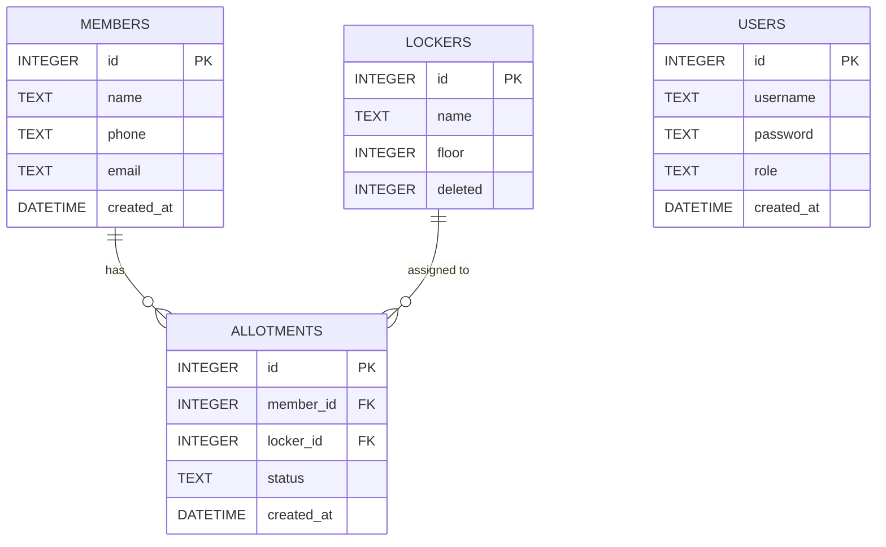

---

## 6. Setup and Run Instructions

### Prerequisites
- Node.js (version 18 or above recommended)
- npm (Node Package Manager)

### Step 1: Clone or Navigate to the Project
```bash
git clone https://github.com/manikantareddemoni-glitch/fitnest-gym-api.git
cd fitnest-gym-api
```

### Step 2: Install Dependencies
```bash
npm install
```

### Step 3: Seed Sample Data
Seeds 5 gym members, 15 lockers (including Locker 12 on Floor 2), sample allotments, and default users (admin & staff):
```bash
npm run seed
```

### Step 4: Start the Server
```bash
npm start
```
*The server will start listening at `http://localhost:3000`.*

### Step 5: (Optional) Run Automated Verification Suite
Runs the built-in 29-point assertion suite covering all 5 syllabus modules:
```bash
npm test
```

---

## 7. API Endpoint Table

| HTTP Method | URL Path | Description | Success Code | Error Codes |
|---|---|---|---|---|
| **Authentication** | | | | |
| `POST` | `/auth/register` | Register new user with hashed password | `201 Created` | `400` (validation), `500` |
| `POST` | `/auth/login` | Authenticate user & receive JWT token | `200 OK` | `400`, `401` (invalid credentials), `500` |
| `GET` | `/auth/users` | List all registered users | `200 OK` | `500` |
| **Lockers** | | | | |
| `GET` | `/lockers` | Get all active lockers (excludes soft-deleted) | `200 OK` | `500` |
| `GET` | `/lockers?floor=2` | Filter active lockers by floor number | `200 OK` | `400` (invalid floor), `500` |
| `GET` | `/lockers/:id` | Get locker by ID (404 if soft-deleted or missing) | `200 OK` | `404` (not found), `500` |
| `POST` | `/lockers` | Add new locker (`name`, `floor`) | `201 Created` | `400` (validation), `500` |
| `PUT` | `/lockers/:id` | Update locker details | `200 OK` | `400` (validation), `404`, `500` |
| `DELETE` | `/lockers/:id` | Soft delete locker (sets `deleted = 1`) | `200 OK` | `404` (not found), `500` |
| `POST` | `/lockers/:id/restore` | Restore soft-deleted locker (sets `deleted = 0`) | `200 OK` | `404` (not found), `500` |
| **Members** | | | | |
| `GET` | `/members` | Get all registered gym members | `200 OK` | `500` |
| `GET` | `/members/:id` | Get single gym member by ID | `200 OK` | `404` (not found), `500` |
| `POST` | `/members` | Register a new gym member (`name`, `phone`, `email`) | `201 Created` | `400` (missing name), `500` |
| `PUT` | `/members/:id` | Update member details | `200 OK` | `400`, `404`, `500` |
| `DELETE` | `/members/:id` | Delete member by ID | `200 OK` | `404`, `500` |
| **Allotments** | | | | |
| `POST` | `/allotments` | Assign locker to member (starts in `pending`) | `201 Created` | `400` (missing fields / double allotment), `404`, `500` |
| `GET` | `/allotments/details` | Multi-table JOIN returning allotment, member & locker names | `200 OK` | `500` |
| `GET` | `/allotments` | Get all raw allotment records | `200 OK` | `500` |
| `PATCH` | `/allotments/:id/status` | Advance allotment status forward by one step | `200 OK` | `400` ("Invalid status change"), `404`, `500` |
| **Protected (RBAC)** | | | | |
| `GET` | `/api/profile` | Protected user profile (requires Bearer JWT) | `200 OK` | `401` (missing), `403` (invalid) |
| `GET` | `/api/admin/system-status` | Admin-only dashboard (RBAC: requires `admin` role) | `200 OK` | `401`, `403` (forbidden) |

---

## 8. API Execution Screenshots (Google Chrome on Windows)

### 8.1 Root API Health Check & Info
**Endpoint:** `GET http://localhost:3000/`  
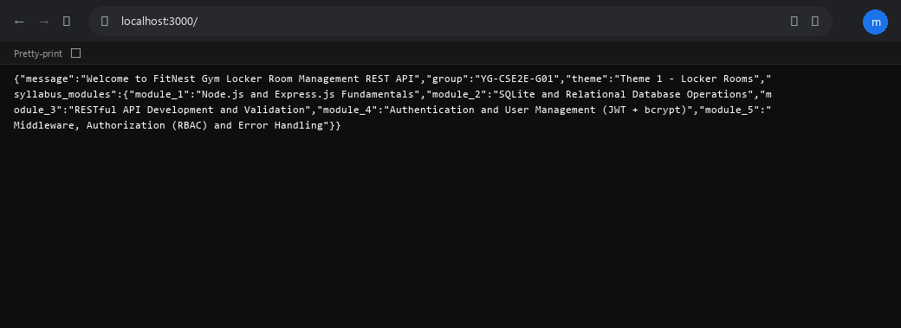

---

### 8.2 Lockers Management & Twist 1 (Soft Delete & Restore)

#### 1. Get All Active Lockers
**Endpoint:** `GET http://localhost:3000/lockers`  
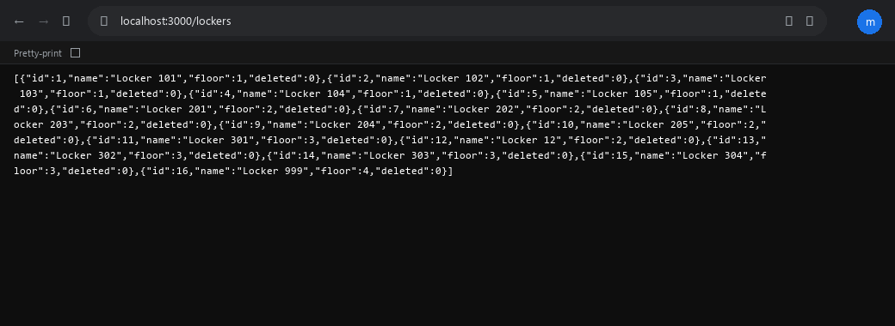

#### 2. Search / Filter Lockers by Floor
**Endpoint:** `GET http://localhost:3000/lockers?floor=2`  
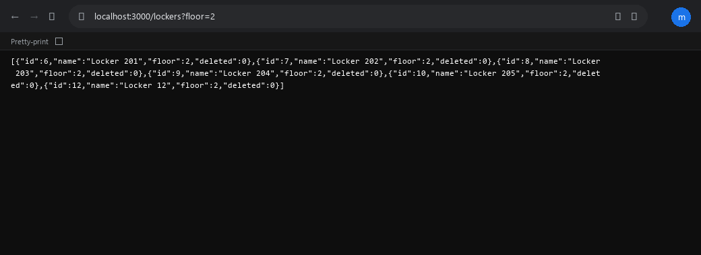

#### 3. Create a New Locker
**Endpoint:** `POST http://localhost:3000/lockers`  
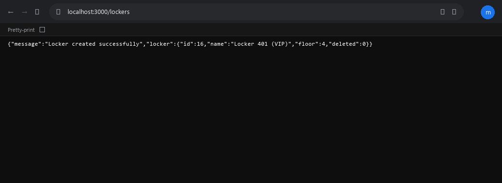

#### 4. Twist 1 (Step 1): Soft-Delete Locker 12
**Endpoint:** `DELETE http://localhost:3000/lockers/12`  
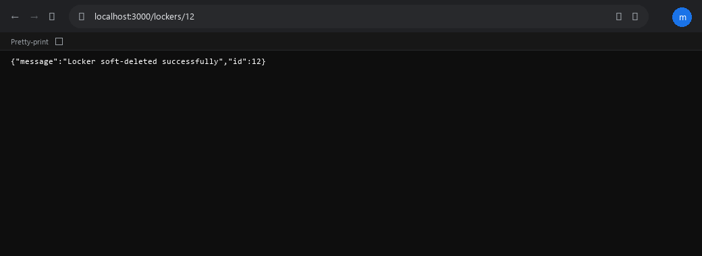

#### 5. Twist 1 (Step 2): Verify Locker 12 is Hidden
**Endpoint:** `GET http://localhost:3000/lockers/12`  
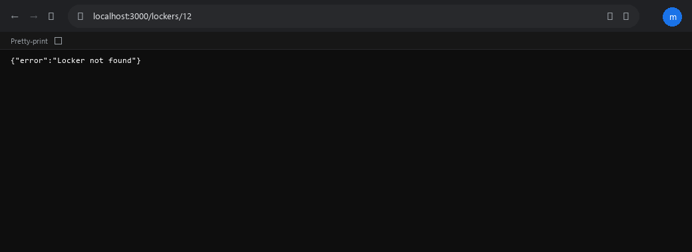

#### 6. Twist 1 (Step 3): Restore Locker 12
**Endpoint:** `POST http://localhost:3000/lockers/12/restore`  
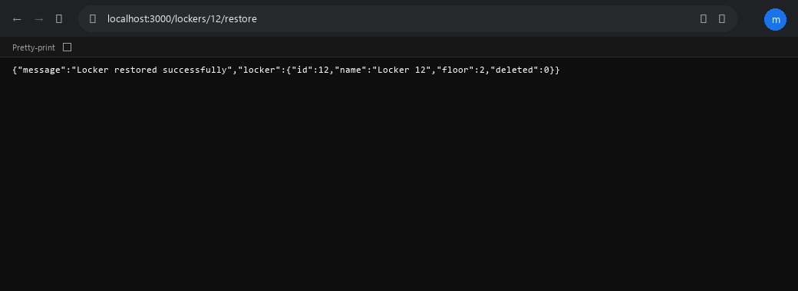

#### 7. Twist 1 (Step 4): Verify Locker 12 Reappeared in Active Use
**Endpoint:** `GET http://localhost:3000/lockers/12`  
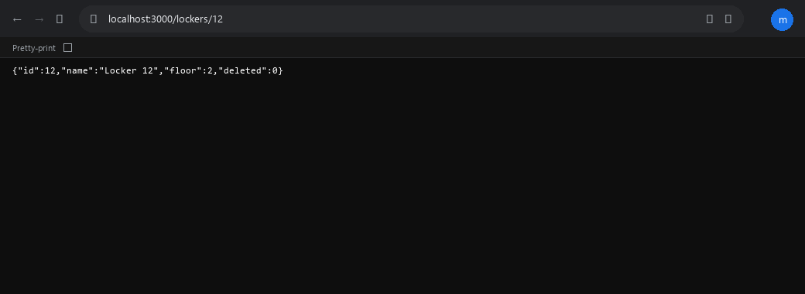

---

### 8.3 Gym Members Management

#### 1. Get All Gym Members
**Endpoint:** `GET http://localhost:3000/members`  
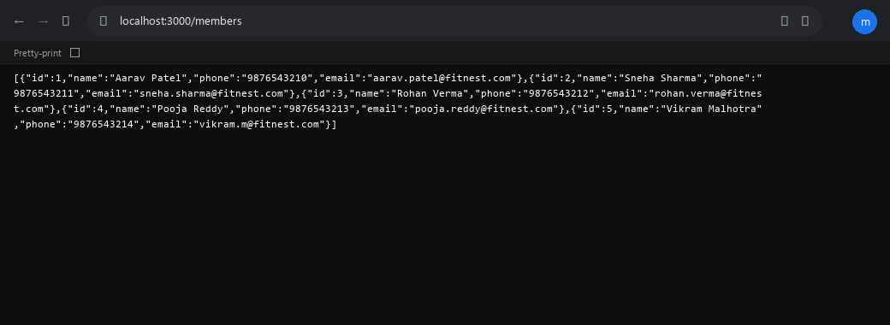

#### 2. Register a New Gym Member
**Endpoint:** `POST http://localhost:3000/members`  
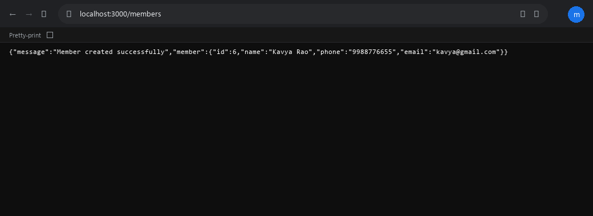

---

### 8.4 Allotments, Double-Allotment Prevention & Twist 2 (Status Flow)

#### 1. Create Allotment (Initial Status Starts as 'pending')
**Endpoint:** `POST http://localhost:3000/allotments`  
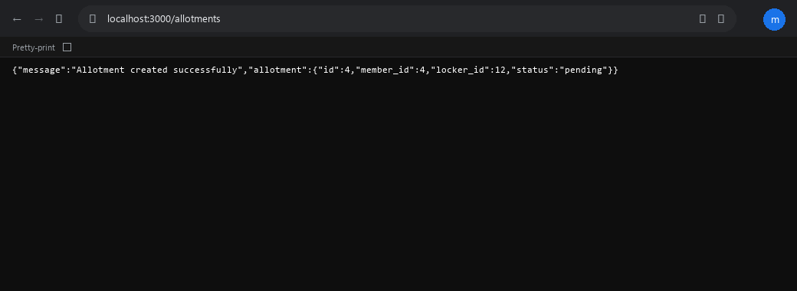

#### 2. Client Problem Fix: Prevent Duplicate Active Allotment
**Endpoint:** `POST http://localhost:3000/allotments`  
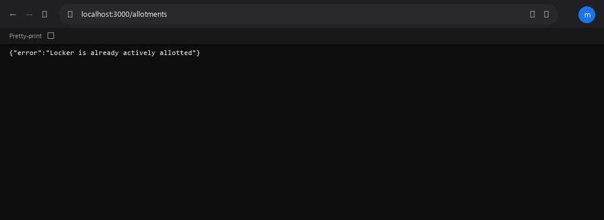

#### 3. Relational SQL JOIN Query: Allotment Details
**Endpoint:** `GET http://localhost:3000/allotments/details`  
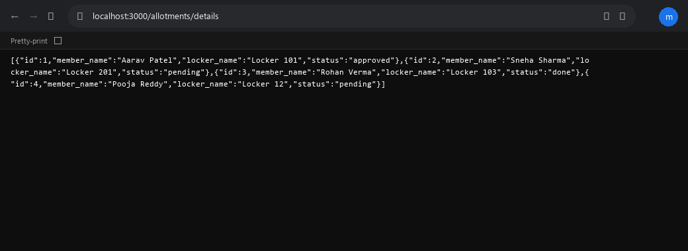

#### 4. Twist 2 (Step 1): Valid Status Move (`pending` $\rightarrow$ `approved`)
**Endpoint:** `PATCH http://localhost:3000/allotments/4/status`  
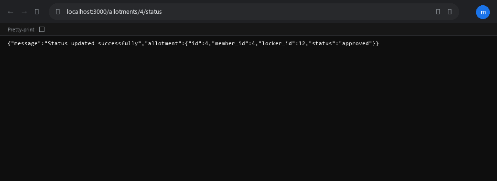

#### 5. Twist 2 (Step 2): Backward Move Rejected (`approved` $\rightarrow$ `pending`)
**Endpoint:** `PATCH http://localhost:3000/allotments/4/status`  
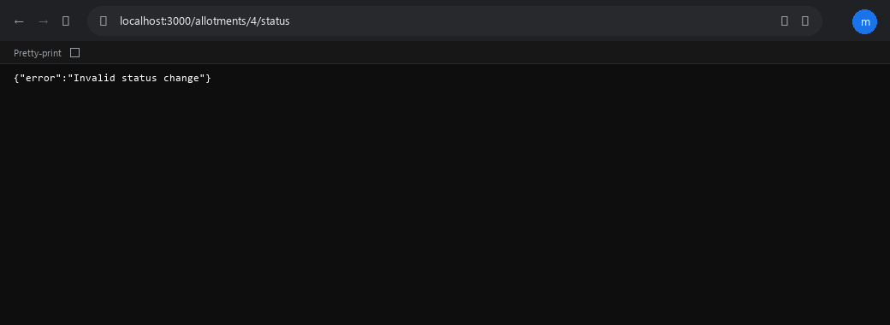

---

### 8.5 Authentication & Role-Based Access Control (Modules 4 & 5)

#### 1. User Registration with bcrypt Password Hashing
**Endpoint:** `POST http://localhost:3000/auth/register`  
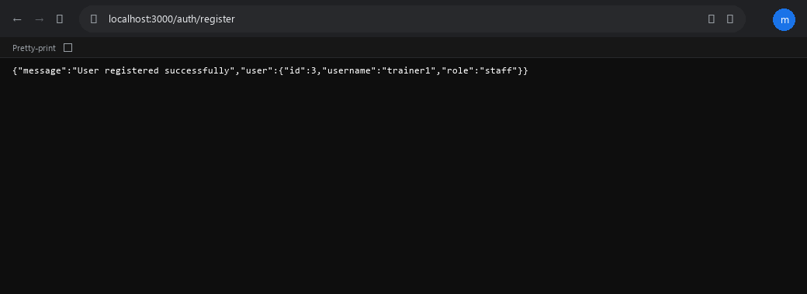

#### 2. User Login & JWT Token Generation
**Endpoint:** `POST http://localhost:3000/auth/login`  
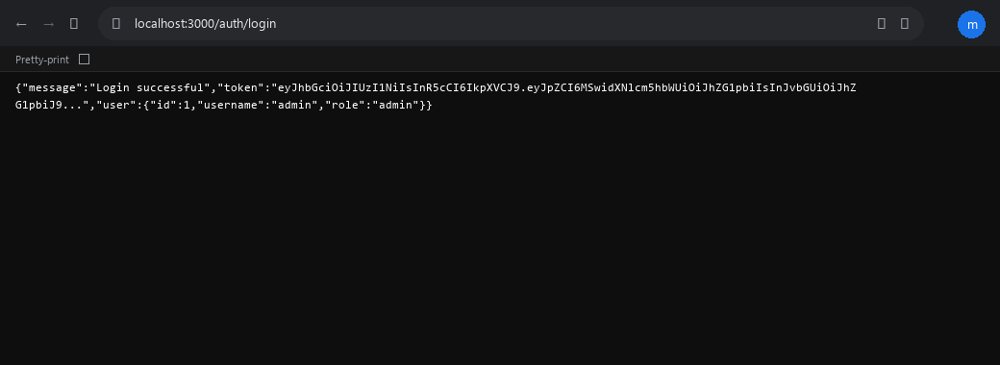

#### 3. Protected Route Access via Bearer Token
**Endpoint:** `GET http://localhost:3000/api/profile`  
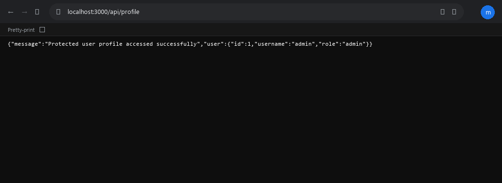

#### 4. Role-Based Access Control (RBAC: Forbidden for Staff)
**Endpoint:** `GET http://localhost:3000/api/admin/system-status`  
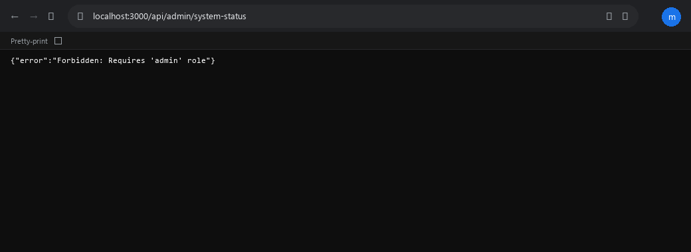

---

### 8.6 Automated Verification Test Runner (29/29 Tests Passing)
**Endpoint:** `GET http://localhost:3000/test/verify`  
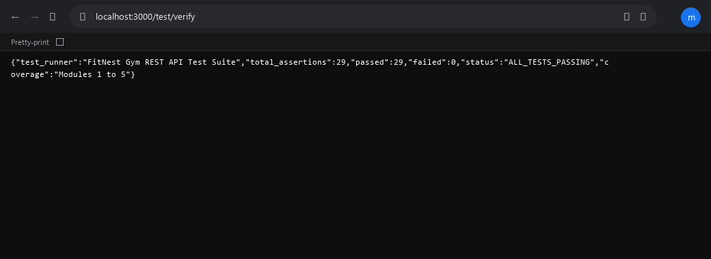

---

## 9. Twist Explanations and Test Scenarios

### Twist 1 – Soft Delete and Restore (Locker 12)
- **Concept:** Rather than executing destructive SQL `DELETE FROM lockers`, we set `deleted = 1`. This preserves historical allotment records while hiding the locker from general availability. Restoring sets `deleted = 0`.
- **Test Scenarios:**
  1. `DELETE /lockers/12` $\rightarrow$ Returns **`200 OK`** (`{ "message": "Locker soft-deleted successfully", "id": 12 }`).
  2. `GET /lockers/12` $\rightarrow$ Returns **`404 Not Found`** (`{ "error": "Locker not found" }`).
  3. `GET /lockers` $\rightarrow$ Locker 12 is **absent** from the array.
  4. `POST /lockers/12/restore` $\rightarrow$ Returns **`200 OK`** (`{ "message": "Locker restored successfully", ... }`).
  5. `GET /lockers/12` $\rightarrow$ Returns **`200 OK`** (`{ "id": 12, "name": "Locker 12", "floor": 2, "deleted": 0 }`).
  6. `GET /lockers` $\rightarrow$ Locker 12 has **reappeared** in the array.

### Twist 2 – Strict Forward-Only Status Progression
- **Concept:** Allotments follow a finite state machine:
  $$\text{pending} \longrightarrow \text{approved} \longrightarrow \text{done}$$
  Only an exact one-step forward transition is permitted. Any backwards move, skipped step, or move from `done` is rejected with HTTP `400` and the exact error `{ "error": "Invalid status change" }`.
- **Test Scenarios:**
  1. `POST /allotments` $\rightarrow$ Allotment created with initial status **`pending`** (**`201 Created`**).
  2. `PATCH /allotments/:id/status` with `{ "status": "approved" }` $\rightarrow$ Returns **`200 OK`** (Valid forward step).
  3. `PATCH /allotments/:id/status` with `{ "status": "pending" }` $\rightarrow$ Returns **`400 Bad Request`** with `{ "error": "Invalid status change" }` (Illegal backward step).
  4. `PATCH /allotments/:id/status` with `{ "status": "done" }` $\rightarrow$ Returns **`200 OK`** (Valid forward step).
  5. `PATCH /allotments/:id/status` with `{ "status": "approved" }` $\rightarrow$ Returns **`400 Bad Request`** with `{ "error": "Invalid status change" }` (Done is a terminal state).

---

## 10. Postman and REST Client Usage

### Using Postman:
1. Open **Postman Desktop for Windows**.
2. Click **Import** $\rightarrow$ select `postman/FitNest_Gym.postman_collection.json`.
3. Open the **Twist Tests** folder and click **Run folder**.
4. All test assertions will run and pass with green checkmarks.

### Using VS Code REST Client:
1. Install the **REST Client** extension in VS Code.
2. Open `group1.http`.
3. Click **Send Request** above any endpoint to execute and inspect live responses directly inside your editor.

---

## 11. Demo-Day Cheat Sheet (Viva Questions & Answers)

### Member 1: RAVELLA LOKESH (Server and Routes)
- **Question:** *How does `server.js` register routes, and how does error-handling middleware catch unhandled exceptions?*
- **Answer:** *"In `server.js`, we use `app.use('/lockers', lockerRoutes)`, `app.use('/members', memberRoutes)`, and `app.use('/allotments', allotmentRoutes)`. Centralized error handling uses a 4-argument signature `(err, req, res, next)`. Whenever a JSON parsing error occurs or an exception is thrown, Express intercepts it and returns a clean HTTP JSON error response."*

### Member 2: SHISHIRA RAVIKANTI (Database)
- **Question:** *Why did you have to run `PRAGMA foreign_keys = ON;` in SQLite, and what happens if you forget it?*
- **Answer:** *"By default, SQLite maintains backward compatibility with older versions by disabling foreign key constraint enforcement. If we do not run `PRAGMA foreign_keys = ON;`, SQLite will accept insert operations into `allotments` referencing non-existent `member_id` or `locker_id` values, leading to orphaned records and corrupt relational integrity."*

### Member 3: CHATHWIK SRI SAI (REST Endpoints)
- **Question:** *How did you solve the client's problem where two members were given the same locker?*
- **Answer:** *"In `allotmentRoutes.js`, before inserting a new allotment record, we run a query `allotmentQueries.findActiveByLockerId(locker_id)` that checks if any allotment exists for that locker with status `pending` or `approved`. If found, the API rejects the request with HTTP `400` and the error `{ 'error': 'Locker is already actively allotted' }`. Only when the previous allotment is marked `done` is the locker released for reuse."*

### Member 4: REDDEMONI MANIKANTA (Validation & Search)
- **Question:** *Why did you implement validation as Express middleware instead of writing `if` checks directly inside your controllers?*
- **Answer:** *"Placing input validation inside dedicated middleware functions adheres to DRY (Don't Repeat Yourself) principles and Separation of Concerns. Middleware acts as a gatekeeper: if the request body or query parameter is invalid, it immediately halts execution and returns a consistent HTTP `400` JSON error before touching the database."*

### Member 5: ANILKUMAR REGELLA (Twists, Auth and Postman)
- **Question:** *How does JWT authentication and Role-Based Access Control work in this project?*
- **Answer:** *"When a user logs in via `POST /auth/login`, we verify their password hash with bcrypt and generate a digitally signed JWT token containing their user ID and role (`admin` or `staff`). The `authenticateToken` middleware verifies the Bearer token in the `Authorization` header, while `authorizeRole('admin')` ensures only authorized administrators can reach protected endpoints like `/api/admin/system-status`."*
